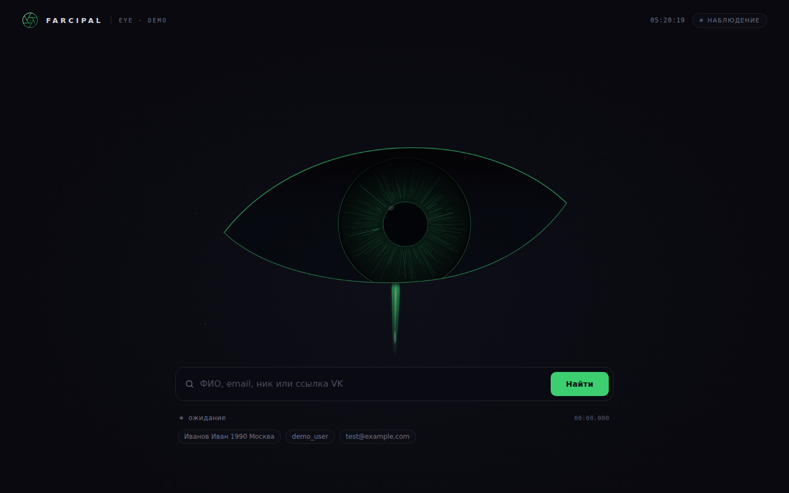
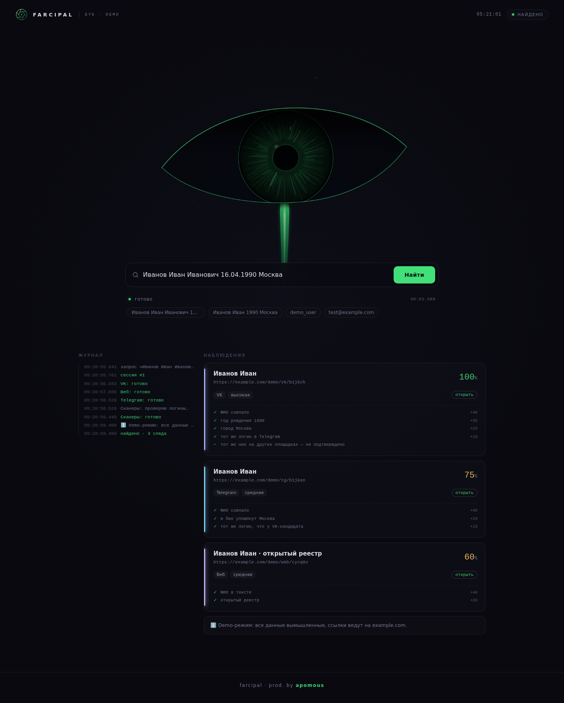
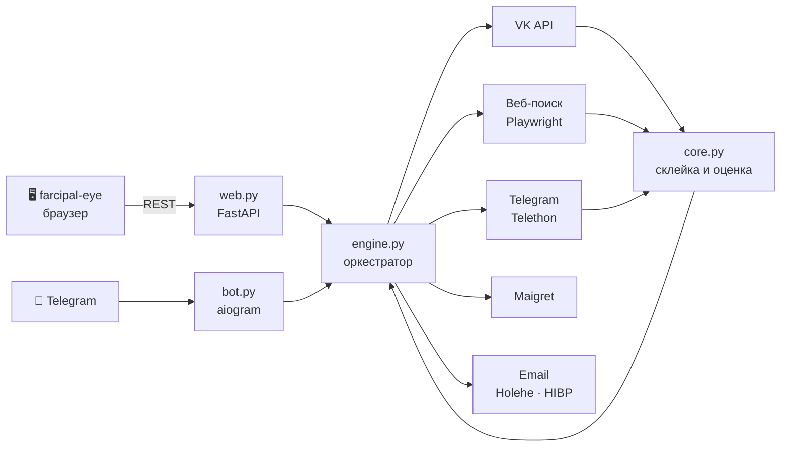

<div align="center">



<br />

# 🧿 FARCIPAL · BACKEND

**OSINT-движок по открытым источникам.**
Находит публичные профили, склеивает их между собой и честно объясняет, насколько можно доверять каждому совпадению.

<br />

[](https://github.com/apomous/farcipal-backend/actions/workflows/tests.yml)


[Возможности](#-возможности) · [Как считается рейтинг](#-как-считается-рейтинг) · [Архитектура](#-архитектура) · [Быстрый старт](#-быстрый-старт) · [Настройка](#-настройка) · [API](#-rest-api) · [Ограничения](#-ограничения) · [Ответственное использование](#-ответственное-использование)

</div>

---

## ✨ Возможности

Один запрос запускает несколько источников параллельно. Результаты приходят по мере готовности и сводятся в один отчёт.

| Источник | Что делает |
| --- | --- |
| 🟦 **VK** | Проверяет типовые логины, сгенерированные из ФИО, и профили, найденные через веб. Поиск `users.search` используется, если VK его разрешает |
| ✈️ **Telegram** | Публичный поиск по имени и проверка логинов через Telethon (необязательно) |
| 🌐 **Веб** | Playwright открывает DuckDuckGo и Bing, достаёт упоминания и отсекает нерелевантное |
| 🔎 **Maigret** | Ищет тот же ник на сотнях сайтов. Результат показывается как справка и баллов не даёт |
| 📧 **Email** | Holehe показывает сервисы, где зарегистрирован адрес, Have I Been Pwned показывает утечки (нужен платный ключ HIBP) |

**Что умеет сверх этого**

- 🧩 **Склейка.** Если логин в Telegram совпадает с логином VK-кандидата, оба получают плюс.
- 🎯 **Честная оценка.** Кандидат с другим годом или днём рождения отсекается. Совпадение ника по другим сайтам баллов не даёт, потому что ник не доказывает личность.
- 🧾 **Объяснимый результат.** У каждого совпадения есть разбор: из чего набран процент.
- 🤖 **Два интерфейса.** Telegram-бот и REST API с сайтом [farcipal-eye](https://github.com/apomous/farcipal-eye).
- 💾 **Кэш и история** в SQLite, логи с ротацией.

<table>
  <tr>
    <td></td>
  </tr>
</table>

## 🎯 Как считается рейтинг

Поисковый запрос выглядит так: `Фамилия Имя [Отчество] [год или ДД.ММ.ГГГГ] [город]`. Чем больше деталей, тем точнее результат.

**Профиль VK и Telegram**

| Признак | Баллы |
| --- | --- |
| ФИО совпало | `+40` |
| Год рождения совпал | `+35` |
| День и месяц рождения совпали | `+20` |
| Город совпал | `+25` |
| Город в профиле другой | `−10` |
| Год или день и месяц рождения **другие** | профиль отбрасывается |
| Telegram: год или город упомянут в био | `+20` за каждое |
| Telegram: логин похож на ФИО | `+5` |
| Логин в Telegram совпал с логином VK-кандидата | `+30` (Telegram) и `+10` (VK) |

**Упоминание в вебе**

| Признак | Баллы |
| --- | --- |
| ФИО в тексте | `+40` |
| Отчество, год, город в тексте | `+20` за каждое |
| Открытый реестр (ЕГРЮЛ-агрегаторы и т. п.) | `+20` |
| Профиль на известной площадке | `+10` |

Показываются совпадения от **55%**. От 80% уверенность высокая, 55–79% средняя. Без года рождения и города бот честно предупреждает, что однофамильцев будет много, и не выдаёт случайных людей.

## 🏗 Архитектура



`core.py` не зависит от сети и покрыт тестами: разбор запроса, генерация логинов, оценка и склейка.

## 🚀 Быстрый старт

Нужен **Python 3.10 или новее**.

### 🪟 Windows

1. Скачайте репозиторий и откройте папку `scripts`.
2. Запустите **`setup.bat`**: он поставит библиотеки, создаст файл `.env` и откроет его.
3. Впишите ключи (см. [Настройка](#-настройка)) и сохраните.
4. Запускайте **`run_bot.bat`** (Telegram-бот) или **`run_web.bat`** (сайт на <http://localhost:8000>).

Чтобы запускать двойным кликом с рабочего стола, один раз выполните `scripts/make_shortcuts.bat`: на рабочем столе появятся ярлыки с иконками.

### 🐧 Linux и 🍎 macOS

```bash
git clone https://github.com/apomous/farcipal-backend.git
cd farcipal-backend

python -m venv .venv && source .venv/bin/activate
pip install -r requirements.txt
playwright install chromium

cp .env.example .env        # впишите ключи
python bot.py               # Telegram-бот
python -m uvicorn web:app --host 127.0.0.1 --port 8000   # сайт и API
```

### 🖥 Подключить интерфейс

Сайт лежит в отдельном репозитории. Клонируйте его в папку `ui`, и бэкенд отдаст его сам:

```bash
git clone https://github.com/apomous/farcipal-eye.git ui
```

Откройте <http://localhost:8000>, логин `admin`, пароль из `.env`. Если интерфейса нет, бэкенд покажет подсказку, а API будет работать как обычно.

## 🔧 Настройка

Все настройки лежат в файле **`.env`**. Шаблон: [`.env.example`](.env.example). Файл `.env` в git не попадает.

| Переменная | Нужна для | Что это |
| --- | --- | --- |
| `VK_TOKEN` | всегда | Сервисный ключ приложения VK |
| `BOT_TOKEN` | бот | Токен от [@BotFather](https://t.me/BotFather) |
| `ALLOWED_IDS` | бот | Telegram ID, которым можно пользоваться ботом, через запятую. Узнать свой можно у [@userinfobot](https://t.me/userinfobot). Без списка бот не запустится |
| `WEB_USER` / `WEB_PASS` | сайт | Логин (по умолчанию `admin`) и пароль для входа. Без пароля сайт не запустится |
| `TG_API_ID` / `TG_API_HASH` | поиск в Telegram | Данные приложения с [my.telegram.org](https://my.telegram.org). После этого один раз выполните `python tg_login.py` |
| `HIBP_API_KEY` | утечки по email | Платный ключ [Have I Been Pwned](https://haveibeenpwned.com/API/Key). Без него проверка утечек пропускается |
| `EXTRA_SCANNERS` | по желанию | Дополнительные сканеры ников через запятую: `naminter,aliens,argis`. По умолчанию выключены |
| `UI_DIR` | по желанию | Путь к интерфейсу, если он лежит не в `ui` |

<details>
<summary><b>🔑 Как получить ключ VK</b></summary>

Приложение создаётся в кабинете [VK ID для бизнеса](https://id.vk.ru/about/business/go). В его настройках берите **сервисный ключ доступа**, это и есть `VK_TOKEN`.

Проверить ключ можно командой `python check_vk.py` (или `scripts/check_vk.bat`): она покажет настоящий ответ VK и подскажет, что исправить.

</details>

<details>
<summary><b>🧰 Проверка внешних программ</b></summary>

`python check_tools.py` показывает, какие из программ (`maigret`, `holehe`, `naminter`, `aliens_eye`, `argis`) установлены, и выводит их справку. Дополнительные сканеры по умолчанию выключены, потому что флаги командной строки у них зависят от версии. Сверьте справку с командами в `nick_scanners.py`, прежде чем включать.

</details>

## 🔌 REST API

Доступ защищён HTTP Basic (`WEB_USER` / `WEB_PASS`). Документация Swagger: `/docs`.

| Метод | Путь | Описание |
| --- | --- | --- |
| `POST` | `/search` | Запускает поиск в фоне. Тело: `{"query": "..."}`. Ответ: `{"id": 1}` |
| `GET` | `/result/{id}` | Состояние поиска: ход, промежуточные и итоговые результаты |
| `GET` | `/history?limit=50` | Последние запросы |
| `GET` | `/stats` | Число поисков, среднее время, популярные запросы |
| `GET` | `/health` | Проверка, что сервис жив |

```bash
# запустить поиск
curl -u admin:ПАРОЛЬ -X POST http://localhost:8000/search \
     -H "Content-Type: application/json" \
     -d '{"query": "Иванов Иван 1990 Москва"}'

# забрать результат
curl -u admin:ПАРОЛЬ http://localhost:8000/result/1
```

Формат ответа описан в README интерфейса: [farcipal-eye → Подключение к бэкенду](https://github.com/apomous/farcipal-eye#-подключение-к-бэкенду).

## 🗂 Структура

```text
farcipal-backend/
├── core.py            # разбор запроса, генерация логинов, оценка и склейка (без сети)
├── engine.py          # оркестратор: VK, веб, Telegram, Maigret, email
├── web.py             # FastAPI: REST API и раздача интерфейса
├── bot.py             # Telegram-бот на aiogram
├── tg.py              # поиск в Telegram через Telethon
├── tg_login.py        # одноразовый вход в Telegram-аккаунт
├── email_osint.py     # Holehe и Have I Been Pwned
├── nick_scanners.py   # дополнительные сканеры ников (по умолчанию выключены)
├── config.py          # загрузка .env
├── check_vk.py        # диагностика ключа VK
├── check_tools.py     # диагностика внешних программ
├── tests/             # тесты ядра
├── scripts/           # скрипты запуска и ярлыки для Windows
├── docs/              # картинки для README
├── requirements.txt
└── .env.example
```

## 🧪 Тесты

```bash
pip install pytest
pytest
```

Тесты проверяют разбор запросов, генерацию логинов, отсев чужих профилей и склейку VK с Telegram. Сеть для них не нужна.

## 🚧 Ограничения

Это ограничения честного подхода: проект не обращается к утёкшим базам, поэтому полнота у него другая, чем у «пробивных» сервисов.

- **VK закрыл поиск по ФИО** для ключей новых приложений (ошибка `1051`). Кандидаты берутся из веба и по типовым логинам, поэтому покрытие меньше.
- Человека, у которого логин не похож на имя и профиль не попадает в выдачу поисковиков, по ФИО найти не получится.
- **Поисковики** иногда отдают капчу headless-браузеру. Такой движок пропускается, а селекторы могут устареть, если сайт поменяет вёрстку.
- **Telegram** находит только пользователей с публичным username и ограничивает частоту запросов.
- Процент уверенности это оценка, а не доказательство. По нему нельзя принимать решения о человеке.

<details>
<summary><b>🩺 Если что-то не работает</b></summary>

| Симптом | Что делать |
| --- | --- |
| `Не заполнено VK_TOKEN в файле .env` | Откройте `.env`, впишите значение без пробелов и кавычек, сохраните |
| VK: `код 1051` в примечаниях | Это ограничение VK, а не ошибка. Подробности выше |
| VK: `код 5` или `28` | Неверный тип ключа. Нужен именно сервисный ключ приложения. Проверьте `python check_vk.py` |
| Пустой веб-поиск | Скорее всего, капча. Попробуйте позже или с другой сети |
| На сайте только подсказка про интерфейс | Выполните `git clone https://github.com/apomous/farcipal-eye.git ui` |
| `Too many attempts` на my.telegram.org | Ограничение Telegram: подождите, смените сеть или браузер. Бот работает и без поиска по Telegram |

</details>

## 🛡 Ответственное использование

Проект предназначен для **проверки себя, контрагентов и исследований на основе открытых данных**, а также для обучения.

**Чего здесь нет и не будет:** утёкших баз, «пробива», обхода защиты и доступа к закрытым данным.

Публичные данные остаются персональными. В разных странах за их сбор и распространение без согласия человека отвечают разные законы: в России это 152-ФЗ и ст. 137 УК РФ, в ЕС GDPR. Автор не несёт ответственности за использование проекта. Запускайте его на своих данных или с согласия человека, не собирайте досье на посторонних и не передавайте результаты третьим лицам. Это не юридическая консультация.

Безопасность по умолчанию:

- бот отвечает только Telegram ID из `ALLOWED_IDS`;
- сайт закрыт паролем и в `scripts/run_web.bat` слушает только `127.0.0.1`;
- ключи лежат в `.env`, а сессия Telegram в `*.session`, оба файла игнорируются git. Не публикуйте их;
- файлы `cache.db`, `web.db` и `osint.log` хранят ваши запросы, периодически удаляйте их.

Если выставляете сервис в интернет, ставьте его за HTTPS (nginx или Caddy) и используйте длинный пароль.

## 🗺 Планы

- [ ] Граф связей между найденными аккаунтами
- [ ] PDF-отчёт по поиску
- [ ] Открытые реестры: ЕГРЮЛ/ЕГРИП, картотека арбитражных дел
- [ ] Источники: GitHub, Habr, OK.ru
- [ ] Очередь задач для тяжёлых операций

## 🌍 English

<details>
<summary>Short summary</summary>

**FARCIPAL backend** is an OSINT engine that works with open sources only (no leaked databases). For a query like `Surname Name 1990 City` it searches VK, the public web (Playwright), Telegram (Telethon) and username scanners (Maigret), then **merges accounts and scores every match with a transparent breakdown** (name +40, birth year +35, city +25, same login on VK and Telegram +30 …). Wrong birth year or birth day/month discards a candidate. It ships a Telegram bot and a REST API (FastAPI) that serves the [farcipal-eye](https://github.com/apomous/farcipal-eye) frontend. Python 3.10+, configuration through `.env`, core logic is covered by tests. Use it on your own data or with consent; see the *Ответственное использование* section.

</details>

## 📄 Лицензия

[MIT](LICENSE) © 2026 apomous
